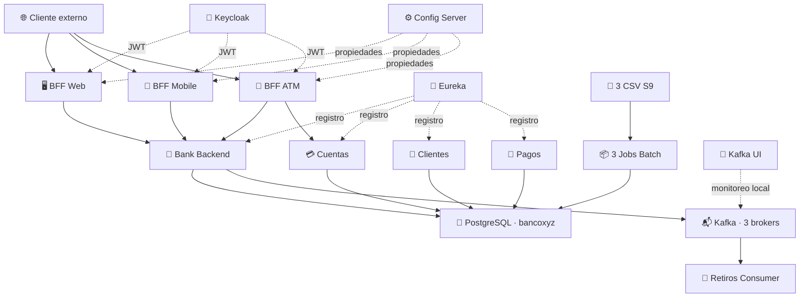
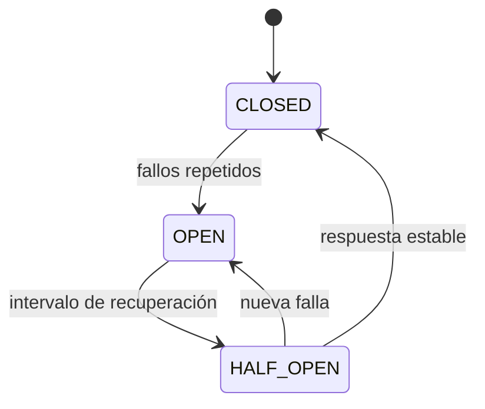
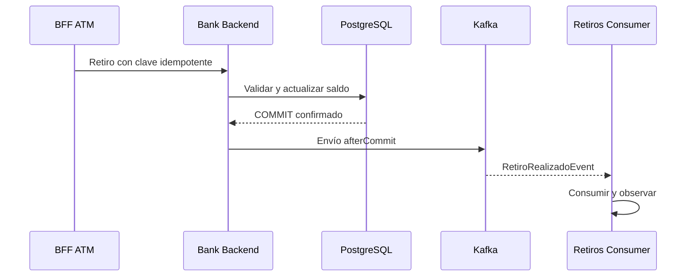

# 🏦 Propuesta Técnica — BancoXYZ

> **Microservicios resilientes, migración Batch y arquitectura orientada a eventos**
> **Desarrollo Backend III (PBY2203) · Semana 9 · Evaluación Final Transversal**
> **Autora: Natalia Alvarado**

---

## 1. Contexto y objetivo de la propuesta

BancoXYZ moderniza un sistema legacy basado en procesos COBOL/Shell y responsabilidades concentradas en un monolito. La finalidad es migrar el procesamiento periódico a **Spring Batch**, desacoplar las operaciones de negocio, optimizar el acceso para Web/Mobile/ATM y preparar un despliegue reproducible con controles de seguridad y resiliencia.

La evolución se organiza en **cinco procesos críticos**, como exige la pauta EFT:

| # | Proceso de modernización | Solución de Semana 9 |
|---:|---|---|
| 1 | Migración de lotes legacy | Tres Jobs Spring Batch (transacciones, intereses y estados anuales) |
| 2 | División del monolito | Microservicios Cuentas, Clientes y Pagos independientes |
| 3 | Especialización por canal | BFF Web, Mobile y ATM con contratos específicos |
| 4 | Seguridad y coordinación distribuidas | OAuth2/Keycloak, Spring Security, Config Server y Eureka |
| 5 | Mensajería asíncrona | Productor y consumidor Kafka para eventos de retiro |

Se conservan los tres CSV originales de Semana 9 como fuentes inmutables. La solución distingue **funcionalidad y pruebas locales comprobadas** de capacidades de infraestructura todavía no verificadas públicamente.

---

## 2. Principios de diseño

La arquitectura mantiene los principios de la propuesta original y los extiende para la evaluación final:

- **responsabilidad única:** separar Cuentas, Clientes, Pagos, Batch y eventos;
- **contratos por consumidor:** no enviar a Mobile datos innecesarios ni mezclar retiros ATM con vistas Web;
- **seguridad por defecto:** autenticación JWT y scopes por canal, negación ante solicitudes no autorizadas;
- **integridad financiera:** transacciones en PostgreSQL, idempotencia y orden estable de bloqueos;
- **fuentes legacy inalterables:** procesar los CSV sin sobrescribirlos;
- **resiliencia:** Circuit Breaker, Retry solo cuando corresponde, Rate Limiter y manejo de errores;
- **mensajería desacoplada:** eventos Kafka después de confirmar la transacción principal;
- **reproducibilidad:** Maven, Docker Compose, migraciones SQL controladas y pruebas repetibles;
- **transparencia:** no declarar TLS público, multi-AZ o garantías productivas sin evidencia real.

---

## 3. Requerimientos clave del negocio y justificación

| Requerimiento | Decisión arquitectónica | Justificación |
|---|---|---|
| **R1. Continuidad e integridad de información bancaria** | Tres Jobs Batch con manejo de errores, reejecución y persistencia idempotente | Minimiza duplicaciones y permite procesar las fuentes existentes sin alterar registros legacy |
| **R2. Atención segura y eficiente por canal** | Tres BFF independientes protegidos por JWT/scopes y HTTPS | Adapta el payload a Web/Mobile/ATM y limita el acceso según el consumidor |
| **R3. Evolución independiente y tolerancia a fallos** | Tres microservicios de dominio, Eureka, Config Server, Resilience4j, Kafka y Compose | Reduce acoplamiento, facilita aislamiento de fallos y permite preparar escalamiento horizontal |

Esta división se apoya en **una base PostgreSQL de aplicación `bancoxyz`**. Compartir instancia simplifica el laboratorio, pero **no significa una migración a una arquitectura de bases distribuidas independientes**; esa separación sería un paso de evolución posterior.

---

## 4. Arquitectura propuesta

La solución local contiene **16 servicios Compose** y Caddy opcional en EC2. El reactor Maven agrupa 13 módulos (11 aplicaciones y dos bibliotecas compartidas). `batch-service` es un proceso independiente, no un decimoséptimo contenedor permanente del stack local. **En EC2, el despliegue `bancoxyz-s9` comprobado incluye solo PostgreSQL y Keycloak**, aislados del stack de Semana 8; los demás servicios quedan pendientes de despliegue allí.



### Responsabilidades principales

| Componente | Responsabilidad |
|---|---|
| Spring Batch | Importación, normalización en código, validación y agregación desde los tres CSV oficiales |
| Bank Backend | Consulta y retiros sobre la representación legacy, publicación de eventos |
| Cuentas Service | Apertura, gestión, mantenimiento y cierre de cuentas administrativas |
| Clientes Service | Administración de perfiles de clientes |
| Pagos Service | Transferencias, pagos y depósitos sobre cuentas de gestión |
| BFF Web/Mobile/ATM | Contratos por canal, JWT, HTTPS y resiliencia |
| Keycloak | OAuth2 / emisión JWT y scopes |
| Config Server + Eureka | Configuración y descubrimiento dinámico |
| PostgreSQL 17 | Persistencia de resultados, saldos, operaciones y metadatos |
| Kafka + Consumer + UI | Transporte asíncrono, recepción y observación de eventos |
| Caddy (opcional EC2) | Terminación TLS pública **solo de Keycloak** |

---

## 5. Decisiones técnicas y justificación

### 5.1 Migración Batch: integridad, errores y escalabilidad

Se implementaron tres Jobs:

```text
movimientos_financieros_diarios.csv → transaccionJob        (paralelo, 3 hilos)
intereses_trimestrales.csv          → cuentaInteresJob      (secuencial, 1 hilo)
estados_financieros_anuales.csv     → estadoCuentaAnualJob  (paralelo, 3 hilos)
```

Spring Batch aporta metadatos de ejecución y mecanismos de restart/retry, procesamiento por chunks, manejo de registros rechazados y separación de lectura, procesamiento y escritura. El Job de intereses es secuencial porque distintos registros pueden actualizar una misma cuenta y un paralelismo sin partición segura podría introducir errores de saldo.

**Evidencia PostgreSQL del 11-10-2026:** ejecuciones `34`, `35` y `36` con estado `COMPLETED`. Las cuatro tablas de negocio conservaron sus conteos **y su huella de contenido** tras reejecución:

| Tabla | Conteo |
|---|---:|
| `cuentas_intereses` | 50 |
| `transacciones_procesadas` | 474 |
| `estados_cuenta_anuales` | 20 |
| `resumen_transacciones_diarias` | 261 |

Los **tres CSV fuente conservaron SHA-256**. No se utilizó el antiguo snapshot SQL para reconstruir los resultados.

### 5.2 Backend for Frontend especializado

Se mantuvieron tres BFF: Web responde con detalle, Mobile entrega representaciones resumidas y ATM incorpora consultas/retiros. Separarlos permite evolucionar los contratos sin afectar los demás canales y reforzar los permisos según el consumidor. El acceso de cada uno requiere JWT con su scope.

### 5.3 Microservicios de Cuentas, Clientes y Pagos

Las tres áreas de negocio se encuentran implementadas como servicios Spring Boot separados:

- **Cuentas:** gestión de cuentas (`cuentas_gestion`) con alta, mantenimiento y cierre.
- **Clientes:** altas, consultas y cambios de perfiles (`clientes_perfil`).
- **Pagos:** solicitudes monetarias liquidadas con `PAGO`, `TRANSFERENCIA` y `DEPOSITO` en PostgreSQL.

Para Pagos se eligió persistencia transaccional de `pagos_saldos` y `pagos_movimientos`, usando una UUID por solicitud. Una solicitud repetida con el mismo cuerpo conserva el resultado; con cuerpo diferente responde `409`; dos solicitudes simultáneas con la misma UUID producen una liquidación. La prueba reinició `pagos-service` y confirmó saldos y movimientos persistidos.

**Delimitación funcional:** el libro de Pagos opera sobre `cuentas_gestion`; el retiro legacy sobre `cuentas_intereses`. No se debe presentar como integración de un único libro mayor regulado o pagos de producción.

### 5.4 OAuth2 con Keycloak

Se centralizó la autenticación en Keycloak, manteniendo tres clientes y scopes:

```text
bff-web-client     → bancoxyz.web
bff-mobile-client  → bancoxyz.mobile
bff-atm-client     → bancoxyz.atm
```

Con Spring Security Resource Server se esperan respuestas `200` con autorización, `401` sin token válido y `403` sin el permiso requerido. En Pagos también se verificó `409` por clave idempotente reutilizada con un cuerpo distinto. Los BFF utilizaron TLS 1.3 local con certificados PKCS12 académicos.

**Evidencia EC2 del 11-10-2026:** dentro del realm `bancoxyz` se observaron los tres clientes habilitados y sus scopes específicos con asignación **Default**. El endpoint de token aceptó `client_credentials` de `bff-web-client`, `bff-mobile-client` y `bff-atm-client`, y devolvió un `access_token` Bearer para cada uno (**3/3**), sin publicar los secretos. Esto verifica la emisión de tokens de Keycloak, **no** aún su validación extremo a extremo por los BFF de Semana 9 en EC2.

### 5.5 Config Server, Eureka y LoadBalancer

Config Server expone propiedades desde `Semana 9/config-repo`, Eureka registra las instancias y Spring Cloud LoadBalancer permite localizar servicios por nombre en vez de IP física. Así las instancias pueden cambiar dentro de Docker sin alterar todos los consumidores.

### 5.6 Resilience4j

Circuit Breaker, Retry, Rate Limiter y timeout limitan el impacto de fallos en llamadas síncronas. `Retry` se restringe a operaciones que puedan repetirse con seguridad. Para retiros monetarios, el diseño conserva idempotencia por clave y evita el reintento HTTP indiscriminado.



### 5.7 Kafka para eventos de retiro



Kafka desacopla la recepción del evento del retiro principal. El topic `bancoxyz.retiros` dispone de **3 particiones, factor de replicación 3 y min ISR=2**. El listener admite pausa, reanudación y consulta de estado bajo autorización JWT. La comprobación de laboratorio confirmó incremento de lag durante la pausa y regreso a `0` al reanudar.

La publicación posterior al commit evita emitir eventos de retiros revertidos, **pero no asegura entrega atómica entre PostgreSQL y Kafka**. La entrega garantizada requeriría un mecanismo adicional diseñado y probado; no se presenta como requisito ya implementado.

### 5.8 Docker y escalabilidad

Docker Compose define una instancia PostgreSQL persistente, tres brokers Kafka, Keycloak, Kafka UI, Config Server, Discovery, Bank Backend, Consumer, BFF y tres microservicios de dominio. `cuentas-service`, `clientes-service` y `pagos-service` no tienen puerto fijo del host ni `container_name`, permitiendo escalar réplicas donde los recursos lo soporten:

```fish
docker compose up -d --build --scale cuentas-service=2 --scale clientes-service=2 --scale pagos-service=2
```

Esto demuestra **configuración para escalado local**, no todavía alta disponibilidad multi-AZ. Validar cada réplica en Eureka y probar el balanceo antes de afirmar escalabilidad Cloud en el informe EFT.

---

## 6. Diseño de seguridad y exposición de red

| Nivel de exposición | Componente o flujo |
|---|---|
| Expuestos en host (laboratorio) | BFF `:8081/:8082/:8083` con TLS de práctica |
| Loopback del host | PostgreSQL, Keycloak, Eureka, Config Server, Backend, Kafka y Kafka UI |
| Red Docker | Cuentas, Clientes, Pagos, brokers, BFF/backend y dependencias |
| Perfil EC2 previsto | Caddy en `80/443`, HTTPS externo para Keycloak después de configurar DNS |
| EC2 efectivamente comprobada (S9) | PostgreSQL `127.0.0.1:15432`, Keycloak `127.0.0.1:18084`; acceso privado vía SSH, sin dominio público |

Las credenciales se aportan desde `.env` y no se deben versionar. Los certificados `.p12` académicos no confirman confianza pública. El ZIP de trabajo original incluía `.env` y `.git`; **deben excluirse de la entrega** aunque `.gitignore` impida subir `.env` mediante Git.

---

## 7. Decisiones específicas del despliegue Cloud

El repositorio prepara despliegue en EC2 por `Semana 9/scripts/desplegar_ec2_final.sh`, que comprueba Docker, DNS, claves/variables requeridas, checkout Git limpio, recursos, Compose y estados saludables. El perfil `ec2` agrega **Caddy**; su `Caddyfile` publica el endpoint de **Keycloak** con TLS público si existe un dominio real configurado.

**Estado comprobado (11-10-2026):** `main` y el checkout EC2 `/home/ubuntu/bancoxyzbatch-s9` coinciden en `cf4605f`. El archivo `docker-compose.s9.ec2.yml` utiliza el proyecto `bancoxyz-s9`, diferente de `bancoxyzbatch` (Semana 8). En EC2 se inició PostgreSQL 17 y Keycloak 26.8.0 de S9 con su red, volumen, puertos loopback y secretos independientes. Se autenticó al administrador por un túnel SSH desde el equipo local y se probaron los tres tokens de clientes OAuth2. Los **13 contenedores de Semana 8** permanecieron activos. En el host había aproximadamente 2,6 GiB de RAM disponible, sin swap; no se inició el resto de S9 para evitar competir por recursos.

**Limitación:** no existe dominio público configurado ni certificado HTTPS público; Caddy no se utilizó. Keycloak se inició en modo `start-dev` para la **demostración privada**, con advertencia de administrador temporal. Las pruebas AWS de Batch, BFF, Kafka y Pagos de S9 **no están realizadas**. No confundir esta prueba parcial con despliegue completo ni TLS de producción.

### Issuer público y token endpoint interno

```text
KEYCLOAK_PUBLIC_URL   → https://auth.DOMINIO_REAL
OAUTH2_ISSUER_URI     → https://auth.DOMINIO_REAL/realms/bancoxyz
OAUTH2_TOKEN_URL      → URL de token accesible desde cada consumidor (ejemplo para despliegue futuro)
```

**Acceso privado realmente probado en EC2:**

```text
KEYCLOAK_PUBLIC_URL   → http://localhost:18084
OAUTH2_ISSUER_URI     → http://localhost:18084/realms/bancoxyz
OAUTH2_TOKEN_URL      → http://localhost:18084/realms/bancoxyz/protocol/openid-connect/token
```

Estas URLs funcionan para pruebas desde el equipo administrador a través de SSH y para consultas locales del host cuando corresponda. **No son automáticamente accesibles desde otros contenedores ni constituyen un issuer público.**

### Kafka local frente a Kafka multi-AZ

El Compose académico utiliza `PLAINTEXT` en tres brokers del mismo servidor. Un Kafka administrado/multi-AZ con TLS/SASL y monitoreo centralizado requiere aprovisionamiento real en AWS, red privada y configuración de productores/consumidores; **no se consigue cambiando un valor en `.env`**.

---

## 8. Validación de la propuesta

| Área | Evidencia local Semana 9 | Infraestructura Cloud |
|---|---|---|
| Maven / pruebas | Reactor `BUILD SUCCESS`, Pagos 7/7 tests | Se requiere ejecución del mismo commit |
| Batch | 3 Jobs `COMPLETED`; reejecución idempotente de las 4 tablas | Pendiente de evidencia Cloud |
| CSV | 3 archivos de 1.000 filas; SHA-256 intactos | Pendiente de verificar en despliegue |
| OAuth2 / JWT | 401 ante token inválido; scopes por canal | Realm y scopes verificados; tres tokens Bearer emitidos (3/3) por Keycloak S9 |
| Pagos | 200/APLICADO, UUID repetida sin doble cargo, 409, concurrencia | Laboratorio QA aprobado; no operativa bancaria externa |
| Persistencia Pagos | 4 solicitudes, 7 movimientos únicos, reinicio sin pérdida | Validar si se despliega en Cloud |
| Kafka | 3 brokers, 3 particiones, RF3, min ISR2; eventos y listener | PLAINTEXT y host único local |
| BFF HTTPS | TLS 1.3 cifrado | Certificado público de Keycloak pendiente |
| Docker Compose | Validación estructural aprobada | S9 independiente: `postgres` healthy y `keycloak` accesible; resto del stack pendiente |

**Evidencia puntual última prueba Batch:**

```text
transaccionJob        34  COMPLETED
cuentaInteresJob      35  COMPLETED
estadoCuentaAnualJob  36  COMPLETED
```

---

## 9. Trazabilidad con la pauta de evaluación

| Indicador EFT | Evidencia y ubicación |
|---|---|
| 1. Cinco procesos clave | Tabla de modernización del §1 |
| 2. Tres requerimientos y justificación | Tabla R1/R2/R3 del §3 |
| 3. Tres Batch con manejo de fallos y paralelismo | Código `batch-service`, resultados de las ejecuciones 34/35/36 |
| 4. Tres BFF especializados | `bff-web`, `bff-mobile`, `bff-atm` + scopes JWT |
| 5. Tres microservicios resilientes y Kafka | `cuentas-service`, `clientes-service`, `pagos-service`, Config/Eureka/Resilience4j/Kafka |
| 6. Docker, Cloud y escalamiento | `docker-compose.yml`, Dockerfiles, scripts EC2; evidencia externa a completar |
| 7. Cuatro documentos | `readme.md`, PDF técnico, `instrucciones.md`, `despliegue.md` |
| 8. Video MP4 con webcam (5–7 min) | **Pendiente de grabación** y presentación de cuatro temas |

> La pauta solicita informe PDF generado usando la plantilla oficial del AVA. El PDF de referencia de una etapa anterior no cumple ese requisito por sí solo.

---

## 10. Trade-offs y evolución a producción

La modernización prioriza reproducibilidad y evidencia académica. Antes de tratar dinero real o reclamar alta disponibilidad serían necesarios:

- autorización por titularidad y análisis antifraude;
- conciliación bancaria y contabilidad formal;
- cobertura de fallos entre commit PostgreSQL y entrega Kafka;
- secretos gestionados, rotación y cifrado de comunicaciones internas;
- DNS, TLS público válido y políticas de seguridad Keycloak compatibles;
- PostgreSQL replicado o gestionado con recuperación probada;
- Kafka TLS/SASL con distribución multi-host/multi-AZ;
- trazabilidad, métricas/alertas y logs centralizados;
- despliegues reproducibles y monitoreo de réplicas;
- validación ante caída de procesos, broker, host y zona.

Estos elementos **no se declaran implementados** por el simple hecho de figurar en una arquitectura propuesta.

---

## 11. Resultado técnico

**BancoXYZ Semana 9** cumple el núcleo funcional observado del laboratorio: tres procesos Batch que leen sus CSV oficiales sin alterarlos, microservicios de dominio, tres BFF, autenticación distribuida, Kafka replicado en un host y operaciones monetarias de prueba con idempotencia y persistencia real. En AWS EC2 ya se comprobó de forma **parcial e independiente** la capa PostgreSQL/Keycloak de S9, con realm, scopes y emisión de JWT de los tres clientes; el resto del despliegue Cloud continúa pendiente.

---

**BancoXYZ · Natalia Alvarado · Desarrollo Backend III (PBY2203) · Semana 9**
