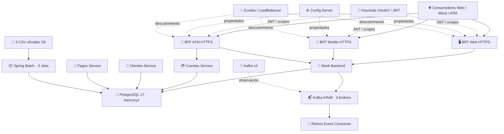
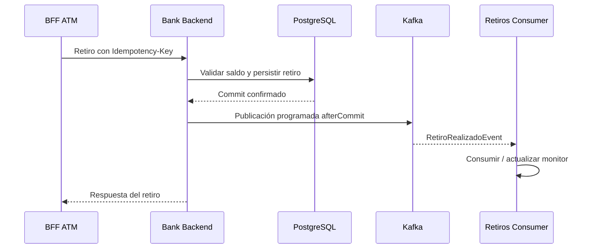
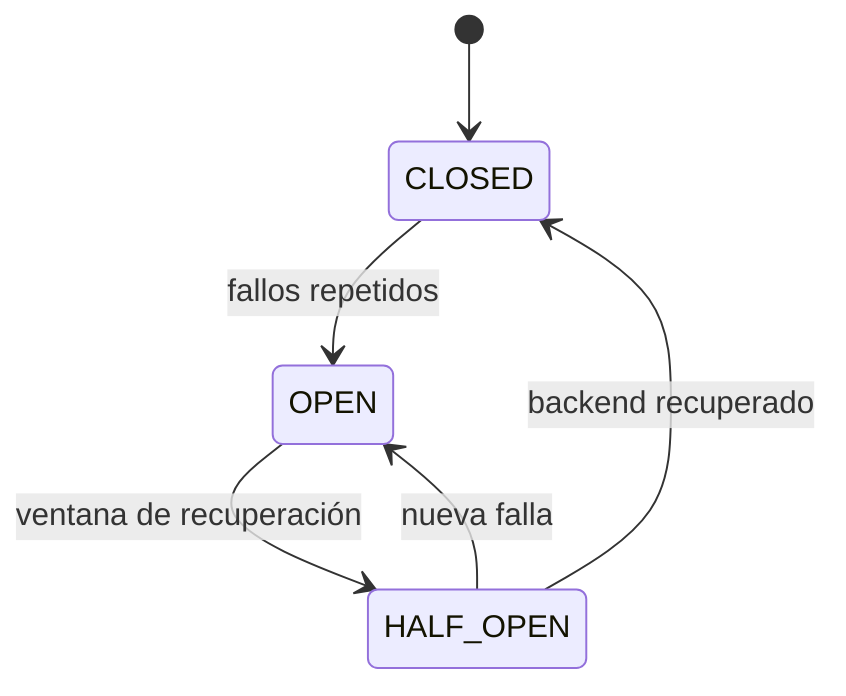

# 🏦 BancoXYZ — Microservicios resilientes, seguros y orientados a eventos

> **Desarrollo Backend III (PBY2203) · Semana 9 · Evaluación Final Transversal**
> **Autora: Natalia Alvarado**
> Spring Batch · Spring Boot 4.1.1 · Java 21 · Spring Cloud · OAuth2 · Keycloak · Resilience4j · Apache Kafka · PostgreSQL 17 · Docker Compose · AWS EC2

---

## ✨ Resumen

BancoXYZ moderniza procesos bancarios legacy hacia una arquitectura distribuida. La **Semana 9** reúne los tres procesos de Spring Batch, tres Backend for Frontend, microservicios independientes de **Cuentas, Clientes y Pagos**, OAuth2 con Keycloak, tolerancia a fallos, mensajería Kafka y despliegue reproducible en contenedores.

**Repositorio GitHub:** https://github.com/LadyRed145/bancoxyzbatch

> 📌 **Publicación:** el repositorio público existe, pero debe sincronizarse con los archivos de Semana 9 antes de entregar. No confundir la validación local con la publicación de la versión final ni con su ejecución actual en AWS.

La composición define **16 servicios locales** y un servicio adicional **Caddy** bajo el perfil opcional `ec2`. `batch-service` se ejecuta como proceso Maven independiente, utilizando **una sola base de datos de aplicación `bancoxyz`** junto con los microservicios.

| Área | Evidencia de Semana 9 | Estado |
|---|---|---|
| Procesos Batch | Tres Jobs; ejecuciones 34, 35 y 36 registradas `COMPLETED` | ✅ Validado en PostgreSQL |
| CSV originales | Tres archivos; 1.000 filas cada uno; SHA-256 sin cambios | ✅ Íntegros |
| Reejecución Batch | Cuatro tablas derivadas con mismo conteo y huella de negocio | ✅ Idempotencia verificada |
| BFF Web, Mobile y ATM | Canales independientes, JWT/scopes, HTTPS TLS 1.3 | ✅ Probado localmente |
| Cuentas y Clientes | Servicios separados y esquema compartido | ✅ Implementados |
| Pagos | Pago, transferencia y depósito; JWT, idempotencia, concurrencia y persistencia tras reinicio | ✅ Pruebas de laboratorio |
| Kafka | Tres brokers KRaft, tres particiones, RF=3, min ISR=2 y consumidor independiente | ✅ Laboratorio local |
| Resilience4j | Circuit Breaker, Retry y Rate Limiter | ✅ Evidencia técnica previa |
| Docker Compose | Una instancia PostgreSQL compartida; configuración validada | ✅ Configurado |
| TLS público y Kafka multi-AZ | Requieren dominio/certificados públicos y despliegue distribuido | 🟡 No certificados |
| AWS EC2 Semana 9 | Automatización preparada; evidencia actual de despliegue pendiente | 🟡 Por verificar |
| Entrega EFT | README, propuesta, instrucciones y despliegue; PDF con plantilla AVA y video | 🟡 Completar evidencia final |

---

## 🧭 Arquitectura final



> El dibujo muestra responsabilidades; **no afirma que los tres servicios de dominio se invoquen desde todos los BFF**. Estos servicios pueden exponerse mediante sus propias API protegidas dentro de la red Docker.

### Flujo natural

```text
CSV oficiales Semana 9
  └─► Spring Batch (leer → procesar → escribir → auditar)
         └─► PostgreSQL 17 / bancoxyz

Cliente → Keycloak / OAuth2 → BFF específico
                          → Spring Cloud Config + Eureka + Resilience4j
                          → Bank Backend / Cuentas
                          → PostgreSQL
                          └─► Kafka → Retiros Event Consumer

Cuentas de gestión → Pagos Service → pagos_saldos + pagos_movimientos (PostgreSQL)
```

---

## 🧩 Servicios del stack

| # | Componente | Responsabilidad | Publicación/local |
|---:|---|---|---|
| 1 | PostgreSQL 17 | Una base `bancoxyz`, persistencia Batch y servicios | `127.0.0.1:5432` |
| 2 | Kafka Broker 1 | Broker/controller KRaft | `127.0.0.1:9092` |
| 3 | Kafka Broker 2 | Broker/controller KRaft | `127.0.0.1:9094` |
| 4 | Kafka Broker 3 | Broker/controller KRaft | `127.0.0.1:9096` |
| 5 | Kafka UI | Exploración de tópicos, particiones y lag | `127.0.0.1:8090` |
| 6 | Keycloak | Autenticación OAuth2 y emisión de JWT | `127.0.0.1:8084` |
| 7 | Config Server | Configuración compartida | `127.0.0.1:8888` |
| 8 | Eureka | Registro y descubrimiento | `127.0.0.1:8761` |
| 9 | Bank Backend | Cuentas legacy, retiros y productor Kafka | `127.0.0.1:8080` |
| 10 | Retiros Event Consumer | Consumidor y administración del listener | `127.0.0.1:8091` |
| 11 | BFF Web | Contrato para navegadores | HTTPS `:8081` |
| 12 | BFF Mobile | Respuesta ligera para móviles | HTTPS `:8082` |
| 13 | BFF ATM | Saldos y retiros | HTTPS `:8083` |
| 14 | Cuentas Service | Gestión de apertura, actualización y cierre | Solo red Docker |
| 15 | Clientes Service | Perfiles y datos de clientes | Solo red Docker |
| 16 | Pagos Service | Pagos, transferencias y depósitos | Solo red Docker |
| 17 | Caddy (perfil `ec2`) | Proxy HTTPS público de **Keycloak** | `:80` y `:443` |

`batch-service` es el ejecutable Batch adicional, **no un servicio permanente de Compose**. El proyecto raíz agrega 13 módulos Maven: 11 aplicaciones y 2 bibliotecas compartidas.

---

## 📦 Migración legacy y Spring Batch

### Cinco procesos críticos de modernización

1. Sustituir el procesamiento legacy de transacciones, intereses y estados anuales por **Spring Batch**.
2. Separar el monolito en microservicios de **Cuentas, Clientes y Pagos**.
3. Implementar **tres BFF** con datos y permisos propios para Web, Mobile y ATM.
4. Distribuir la seguridad con **Spring Security, OAuth2/Keycloak, Eureka y Config Server**.
5. Incorporar **mensajería asíncrona con Kafka**, desacoplando eventos de retiro y consumidor.

### Los tres archivos oficiales de Semana 9

```text
Semana 9/batch-service/src/main/resources/data/
├── movimientos_financieros_diarios.csv
├── intereses_trimestrales.csv
└── estados_financieros_anuales.csv
```

| Job | Fuente CSV | Resultado | Estrategia |
|---|---|---|---|
| `transaccionJob` | `movimientos_financieros_diarios.csv` | Transacciones procesadas y resumen diario | Paralelo, 3 hilos |
| `cuentaInteresJob` | `intereses_trimestrales.csv` | Intereses trimestrales de la fuente y saldos calculados | Secuencial por cuenta |
| `estadoCuentaAnualJob` | `estados_financieros_anuales.csv` | Estados de cuenta consolidados | Paralelo, 3 hilos |

Los procesos combinan readers CSV, processors, writers, chunks, manejo de registros rechazados, skip/retry controlado, metadatos de ejecución y políticas de reejecución. **Los CSV originales no se normalizan ni editan; toda transformación sucede en código o datos derivados.**

### Evidencia real: última ejecución controlada

```text
transaccionJob        → JobExecution 34 → COMPLETED
cuentaInteresJob      → JobExecution 35 → COMPLETED
estadoCuentaAnualJob  → JobExecution 36 → COMPLETED

cuentas_intereses ................. 50
transacciones_procesadas ......... 474
estados_cuenta_anuales ........... 20
resumen_transacciones_diarias .... 261
```

La reejecución comparó **conteo y huella de contenido de negocio** antes/después en las cuatro tablas: coincidieron. Los tres archivos CSV conservaron su SHA-256. Que cada CSV tenga 1.000 filas no significa que las tablas deban tener 1.000 registros; hay normalización, descarte y agregaciones según las reglas de cada Job.

> La prueba demuestra idempotencia observada en este caso y persistencia de resultados, no una garantía absoluta frente a fallos no ensayados o infraestructura distribuida de producción.

---

## 🔐 Seguridad con OAuth2 y Keycloak

### Realm, clientes y scopes

```text
Realm: bancoxyz

bff-web-client     → bancoxyz.web
bff-mobile-client  → bancoxyz.mobile
bff-atm-client     → bancoxyz.atm
```

Los BFF son Resource Servers JWT y exigen su scope. Los tres servicios bancarios también validan JWT; Pagos acepta scopes de los canales configurados.

```text
Token válido + scope autorizado  → HTTP 200
Sin token / token inválido       → HTTP 401
Scope de otro canal              → HTTP 403
Misma Idempotency-Key y otro payload en Pagos → HTTP 409
```

Los BFF realizaron handshake **TLS 1.3** con cifrado `TLS_AES_256_GCM_SHA384` en laboratorio. Los keystores PKCS12 académicos **no prueban confianza pública**. Caddy configura TLS de Keycloak en el perfil `ec2`, pero **su certificado público no se ha certificado en la evidencia actual de Semana 9**.

---

## 🔄 Rutas OAuth2 en Cloud

Con DNS y Caddy operativos, las variables de Cloud deben ser coherentes:

```text
KEYCLOAK_DOMAIN=auth.tu-dominio-real.cl
KEYCLOAK_PUBLIC_URL=https://auth.tu-dominio-real.cl
OAUTH2_ISSUER_URI=https://auth.tu-dominio-real.cl/realms/bancoxyz
OAUTH2_TOKEN_URL=http://127.0.0.1:8084/realms/bancoxyz/protocol/openid-connect/token
```

> Son ejemplos, **no un dominio ya configurado**. El issuer público debe coincidir con el `iss` del JWT. Validar el HTTPS público sin `curl -k` antes de afirmar TLS público válido.

En local pueden utilizarse URLs diferentes, siempre que Keycloak, el issuer del token y los validadores estén alineados.

---

## 🔑 Variables de entorno y secretos

Se utilizan `.env.example` y `.env.ec2.example` como plantillas; `.env` contiene valores locales y está ignorado por Git.

```text
POSTGRES_DB / POSTGRES_USER / POSTGRES_PASSWORD
KEYCLOAK_ADMIN_USERNAME / KEYCLOAK_ADMIN_PASSWORD
KEYCLOAK_PUBLIC_URL / OAUTH2_ISSUER_URI / OAUTH2_TOKEN_URL
OAUTH2_WEB_CLIENT_SECRET / OAUTH2_MOBILE_CLIENT_SECRET / OAUTH2_ATM_CLIENT_SECRET
SSL_KEYSTORE_PASSWORD
KAFKA_MODE / KAFKA_BOOTSTRAP_SERVERS / KAFKA_SECURITY_PROTOCOL
KEYCLOAK_DOMAIN / TLS_EMAIL (en EC2)
```

```fish
cp .env.example .env
chmod 600 .env
# Edita .env localmente, sin publicar credenciales.
```

**Importante:** `.gitignore` evita versionar `.env`, pero **no evita que entre en un ZIP creado desde la carpeta completa**. Excluir explícitamente `.env`, `.git`, credenciales y temporales del paquete de entrega. No guardar secretos de producción en el repositorio.

---

## 📨 Mensajería asíncrona con Kafka



```text
Topic .................... bancoxyz.retiros
Consumer group ........... bancoxyz-retiros-group
Brokers KRaft ............ 3
Particiones .............. 3
Replication Factor ....... 3
min.insync.replicas ...... 2
```

La prueba del listener verificó JWT `401/403/200`, pausa, lag creciente y reanudación con lag final `0`. La publicación **se programa después del commit de BD** para no emitir eventos de transacciones revertidas. Sigue existiendo una ventana de fallo entre la confirmación de BD y la entrega a Kafka: no se declara garantía *exactly-once* entre ambos sistemas.

**Alcance real:** Kafka opera en tres contenedores del mismo host con `PLAINTEXT`; **no** cuenta con TLS/SASL ni con despliegue multi-AZ. Kafka UI permite inspección operativa, pero no reemplaza un sistema de métricas/alertas centralizado.

### Administración segura del listener

```text
GET  /api/kafka/consumer/estado
GET  /api/kafka/consumer/resumen
POST /api/kafka/consumer/pausar
POST /api/kafka/consumer/reanudar
```

Estas rutas requieren JWT y scope administrativo del canal Web. Evitar las pruebas de pausa/retirada en producción sin aislamiento.

---

## 🛡️ Resiliencia con Resilience4j

Los clientes BFF usan **Circuit Breaker, Retry controlado, Rate Limiter y timeout**. Las operaciones monetarias se distinguen de las lecturas: no se habilita un reintento automático a ciegas para un retiro.



Las evidencias anteriores de Resilience4j y del listener sirven de antecedente, pero si el informe final afirma validación Cloud de **esta versión de Semana 9**, debe adjuntar pruebas hechas sobre el despliegue de Semana 9.

---

## ⚙️ Configuración centralizada y Service Discovery

**Config Server `:8888`** sirve propiedades desde `Semana 9/config-repo/`; **Eureka `:8761`** registra los servicios. Los BFF resuelven `BANK-BACKEND` con Spring Cloud LoadBalancer, evitando direcciones IP fijas.

```text
Semana 9/config-repo/
├── bff-web.properties
├── bff-mobile.properties
└── bff-atm.properties
```

La configuración central contiene límites de tiempo, Circuit Breaker, Retry, Rate Limiter, compresión, Eureka y Actuator.

---

## 🌐 Backend for Frontend

### Web — `HTTPS :8081`

```text
GET /api/web/cuentas/{id}
GET /api/web/cuentas/{id}/detalle
```

### Mobile — `HTTPS :8082`

```text
GET /api/mobile/cuentas/{id}/resumen
```

### ATM — `HTTPS :8083`

```text
GET  /api/atm/cuentas/{id}/saldo
POST /api/atm/cuentas/{id}/retiro  (Idempotency-Key)
```

Web entrega representaciones más completas; Mobile prioriza payload reducido y ATM operaciones concretas de cajero. Los certificados locales permiten transporte cifrado HTTPS en los tres canales.

---

## 💳 Microservicios de negocio

| Servicio | Responsabilidad principal | Persistencia |
|---|---|---|
| `cuentas-service` | Crear, consultar, mantener y cerrar cuentas de gestión | `cuentas_gestion` |
| `clientes-service` | Gestionar perfiles y datos de clientes | `clientes_perfil` |
| `pagos-service` | Ejecutar pagos, transferencias y depósitos bajo JWT | `pagos_solicitudes`, `pagos_saldos`, `pagos_movimientos` |

### 💸 Pagos: idempotencia y persistencia reales

```text
POST /api/pagos/solicitudes       → Idempotency-Key: UUID
GET  /api/pagos/solicitudes/{id}
GET  /api/pagos/cuentas/{id}/saldo
```

En laboratorio se comprobaron las tres operaciones con `HTTP 200/APLICADO`; el mismo UUID devuelve el mismo recibo sin doble movimiento; un UUID reutilizado con datos diferentes produce `HTTP 409`; dos solicitudes simultáneas con el mismo UUID generan una liquidación. Después de reiniciar **solo** `pagos-service`, las cuentas y operaciones conservaron sus datos en PostgreSQL.

```text
4 solicitudes aplicadas · 7 movimientos únicos
Saldo QA origen: 997,25 · Saldo QA destino: 522,75
```

**Separación importante:** Pagos liquida contra `cuentas_gestion`; los retiros legacy usan `cuentas_intereses` y su propio endpoint. No son un único libro mayor ni debe representarse esta prueba como integración bancaria productiva completa.

---

## 💾 Persistencia

El proyecto declara **una instancia PostgreSQL 17** y trabaja con la base `bancoxyz`. Las tablas de Spring Batch, Cuentas, Clientes, Pagos, retiros idempotentes y metadatos de Keycloak conviven en esta instancia con sus respectivos esquemas/tablas.

```text
PostgreSQL interno: postgres:5432
PostgreSQL host:    127.0.0.1:5432 (valor por defecto)
Base:               bancoxyz
Volumen:            bancoxyz_postgres_data
```

Los archivos `Semana 9/data/db/` contienen migraciones controladas. `Semana 9/database/01_schema.sql` sigue enlazado a Compose para inicializar un volumen **nuevo**; el archivo histórico `02_seed_processed_snapshot.sql` **no se monta** y no es la fuente actual de Batch.

**No** usar `docker compose down -v`, `TRUNCATE`, `DROP DATABASE` ni volver a cargar el snapshot anterior. `docker compose stop` conserva volúmenes y servicios para reiniciar después.

---

## 🔎 Observabilidad

Spring Boot Actuator publica salud y eventos de resiliencia según servicio. Kafka UI permite revisar brokers, particiones y offsets. PostgreSQL contiene el histórico de ejecuciones Spring Batch.

```text
/actuator/health
/actuator/info
/actuator/circuitbreakers
/actuator/circuitbreakerevents
/actuator/retries
/actuator/retryevents
/actuator/ratelimiters
```

Para observabilidad de producción faltarían alertas, correlación de trazas y monitoreo centralizado.

---

## 📁 Estructura del proyecto

```text
bancoxyzbatch/
├── .env.example
├── .env.ec2.example
├── docker-compose.yml
├── pom.xml                       # reactor Maven (13 módulos)
├── README.md
├── Propuesta_Tecnica.md
├── instrucciones.md
├── despliegue.md
└── Semana 9/
    ├── batch-service/
    │   └── src/main/resources/data/   # tres CSV inalterables
    ├── bank-backend/
    ├── bff/{bff-web,bff-mobile,bff-atm}/
    ├── cuentas-service/
    ├── clientes-service/
    ├── pagos-service/
    ├── config-repo/
    ├── config-server/
    ├── discovery-server/
    ├── retiros-event-consumer/
    ├── shared-contracts/
    ├── shared-resilience/
    ├── data/db/                    # migraciones adicionales
    ├── database/                   # esquema inicial aún referenciado
    ├── caddy/
    ├── keycloak/
    └── scripts/
```

> El árbol representa los archivos **que deben quedar al instalar este paquete documental**. El informe PDF y el MP4 se incorporan a la carpeta final del AVA una vez completados.

---

## 🧱 Build Maven

Desde la raíz del repositorio, en **Fish**:

```fish
./mvnw clean verify
```

Para compilar sin tests:

```fish
./mvnw clean package -DskipTests
```

**No usar `-DskipTests` para certificar el estado de pruebas**. El reactor incluye servicios y bibliotecas compartidas. En la auditoría anterior del código disponible, el reactor terminó `BUILD SUCCESS` y las pruebas de Pagos finalizaron `7/7`.

---

## 🐳 Ejecución local con Docker Compose

```fish
docker compose config --quiet
docker compose up -d --build
docker compose ps
```

Para detener sin borrar datos:

```fish
docker compose stop
```

**Nota:** Compose levanta el stack, pero **no ejecuta automáticamente** los Jobs Batch de los CSV. Para ello se utiliza el verificador controlado descrito en [`instrucciones.md`](instrucciones.md).

### Recursos del runtime

Kafka, Keycloak y Kafka UI tienen límites de memoria configurables. La arquitectura completa requiere recursos suficientes; no se promete disponibilidad de nube por el solo hecho de tener un `docker-compose.yml`.

---

## ☁️ Despliegue en AWS EC2

La versión actual permite levantar Caddy delante de Keycloak mediante perfil `ec2` y automatiza comprobaciones iniciales:

```fish
bash "Semana 9/scripts/desplegar_ec2_final.sh"
```

**Precondiciones:** instancia Linux con Docker, Compose y Git; `.env` específico de EC2; DNS real apuntando a IP pública; puertos 80/443 habilitados; rama publicada y checkout Git limpio. El script verifica esos requisitos y usa `docker compose --profile ec2`.

El despliegue antiguo sirve de referencia operativa, pero no se declara que **la versión final de Semana 9** esté validada en AWS sin la nueva ejecución y sus capturas. Consulta [`despliegue.md`](despliegue.md).

---

## 🌍 Validación externa y TLS

Los tres BFF han realizado handshake **TLS 1.3** en el laboratorio. La validez pública de certificados exige hostname real, autoridad de certificación confiable, certificado vigente y comprobación desde un cliente externo.

```fish
# Sustituye el dominio de ejemplo por el DNS realmente registrado.
curl --fail --show-error https://auth.tu-dominio-real.cl/realms/bancoxyz/.well-known/openid-configuration
```

El fichero `Semana 9/caddy/Caddyfile` publica **Keycloak**, no los tres BFF. Esto distingue HTTPS local de certificados públicos y evita afirmar que Kafka tiene TLS/SASL: sus listeners actuales son `PLAINTEXT`.

---

## 🧰 Scripts de validación

```fish
# Auditoría general, compilación y Batch (altera solo resultados derivados/metadatos):
bash "Semana 9/scripts/cierre_total_bancoxyz_s9.sh" --todo

# Pruebas HTTP monetarias con cuentas de laboratorio (crean datos QA):
bash "Semana 9/scripts/verificar_pagos_tls_kafka_s9.sh" --laboratorio

# Cierre controlado: Pagos + Batch + CSV (modifica metadatos y movimientos QA):
bash "Semana 9/scripts/cierre_final_qa_pagos_csv_s9.sh"

# Estado Kafka y autenticación (sin pruebas destructivas):
fish "Semana 9/scripts/verificar_kafka_cluster.fish"
fish "Semana 9/scripts/verificar_oauth2.fish"

# Limpieza de targets de Maven antes de ZIP:
bash "Semana 9/scripts/limpiar_targets_bancoxyz.sh" --dry-run
bash "Semana 9/scripts/limpiar_targets_bancoxyz.sh"
```

El verificador histórico `verificar_entrega_completa.fish` mantiene comprobaciones desactualizadas y **no es la ruta de aceptación actual**. No ejecutarlo para certificar esta entrega.

---

## ✅ Validación final

| Verificación | Local Semana 9 | AWS EC2 Semana 9 |
|---|:---:|:---:|
| Reactor Maven y JUnit | ✅ | Por comprobar |
| Tres CSV originales íntegros | ✅ | Por comprobar |
| Tres Jobs Batch `COMPLETED` | ✅ | Por comprobar |
| Reejecución Batch sin cambios de negocio | ✅ | Por comprobar |
| Pagos/transferencias/depósitos JWT | ✅ | Por comprobar |
| Repetición y concurrencia idempotentes | ✅ | Por comprobar |
| Persistencia de Pagos tras reinicio | ✅ | Por comprobar |
| TLS 1.3 en los tres BFF | ✅ | Por comprobar |
| Kafka 3 brokers, RF3 y consumidor | ✅ | Por comprobar |
| TLS público Keycloak / Caddy | No certificado | Por comprobar |
| Kafka TLS/SASL y multi-AZ | No implementado | No implementado |
| Escalamiento horizontal de tres microservicios | Configurado; falta evidencia específica | Por comprobar |

---

## 📸 Evidencias y entregables EFT

La rúbrica exige, en una misma carpeta para entrega:

1. **`readme.md`** con enlace al código fuente completo en GitHub (se incluye copia minúscula para AVA; el repositorio usa `README.md`).
2. **Informe técnico en PDF**, basado en la plantilla oficial `PBY2203_EFT_S9_plantilla_PDF` del AVA, con diagramas y evidencias.
3. **`instrucciones.md`** con ejecución y pruebas de componentes.
4. **`despliegue.md`** con pasos detallados en nube.
5. **Video MP4 de 5–7 minutos con webcam** y los cuatro temas solicitados.

> El PDF histórico de etapas anteriores **no reemplaza** al informe final de Semana 9. El MP4 y las capturas de EC2/TLS de esta versión requieren preparación y comprobación aparte.

---

## 🧹 Buenas prácticas aplicadas

- responsabilidad única por servicio y contrato específico por canal;
- JWT, scopes y TLS de laboratorio para los BFF;
- persistencia transaccional en operaciones de Pagos;
- UUID de idempotencia ante solicitudes repetidas y simultáneas;
- Batch con logs de rechazo, retry, restart y procesamiento en paralelo donde es seguro;
- tres CSV fuente inalterables, verificables por SHA-256;
- Config Server, Eureka, LoadBalancer y Resilience4j;
- Kafka producer/consumer desacoplados, con after-commit para eventos;
- volúmenes persistentes y ausencia de limpieza destructiva automática;
- `target/` fuera del ZIP y exclusión de `.env` y `.git`.

---

## 🚀 Consideraciones de producción

La solución es **académica y funcional en laboratorio**. Para dinero real faltaría, entre otros: control de titularidad/autorización monetaria, conciliación y libro mayor formal, recuperación y auditoría regulatoria, gestión de secretos, pruebas de fallos completos, PostgreSQL altamente disponible, despliegue horizontal multi-host, certificados públicos para los accesos externos, Kafka con TLS/SASL y varias zonas de disponibilidad, observabilidad centralizada y pruebas operativas de recuperación.

No son elementos ya certificados por este repositorio; son una **hoja de ruta**, distinta de los criterios probados en la evaluación.

---

## 🎯 Resultado

BancoXYZ **Semana 9** reúne los tres procesos Spring Batch, tres canales BFF, microservicios de Cuentas/Clientes/Pagos, OAuth2, resiliencia, eventos Kafka y persistencia PostgreSQL. Las pruebas locales del **11 de octubre de 2026** validaron las operaciones de Pagos y la reejecución idempotente de los tres CSV oficiales.

```text
Spring Batch ✅
   +
Seguridad y BFF ✅
   +
Microservicios de negocio ✅
   +
Persistencia e idempotencia local ✅
   +
Kafka replicado localmente ✅
   =
BancoXYZ Semana 9 · Cierre técnico local aprobado
```

> **Entrega académica:** la publicación del código final, las pruebas Cloud específicas y los archivos de evidencia pendientes deben completarse antes de declarar el 100 % de la rúbrica.

---

**BancoXYZ · Natalia Alvarado · Desarrollo Backend III (PBY2203) · Semana 9**
